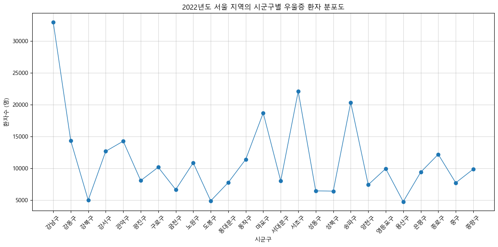
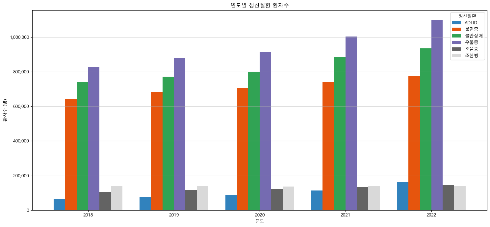
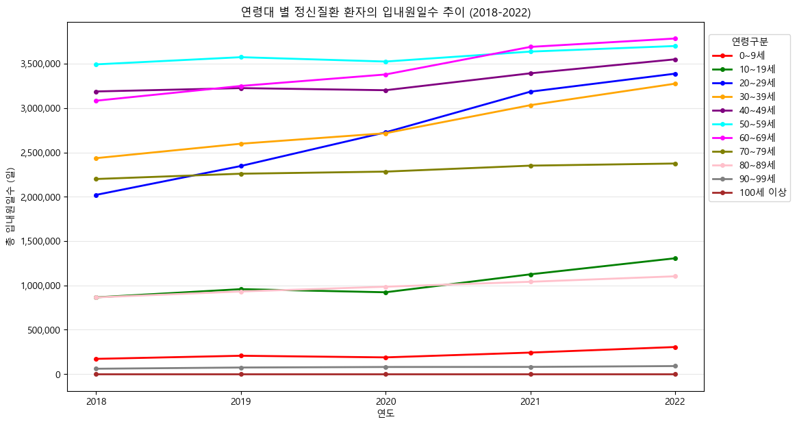

# 정신질환 진료 통계 분석 (2018~2022)

건강보험심사평가원 공공데이터 16만 5천 행을 pandas로 집계해, 지역·질환·연령별 정신질환 진료 추이를 분석한 개인 프로젝트입니다.

| 항목 | 내용 |
| --- | --- |
| 형태 | 개인 프로젝트 |
| 데이터 | 시군구·성별·연령별 주요 정신질환 진료 통계, 165,000행 × 9열, 2018~2022년, 6개 질환 |
| 사용 기술 | Python, pandas, NumPy, matplotlib, Jupyter Notebook |
| 결과물 | [분석 노트북](stats-analysis.ipynb) |

> 같은 데이터를 2024년까지 넓혀 요양급여비용을 예측하는 머신러닝 모델을 만든 팀 프로젝트: [mental-health-cost-prediction](https://github.com/bestlim1/mental-health-cost-prediction)

## 분석 질문과 결과

### 1. 서울에서 우울증 환자가 많은 자치구는 어디인가

2022년 기준 강남구 32,947명, 서초구 22,069명, 송파구 20,329명 순입니다. 인구가 가장 많은 송파구가 3위여서, 환자수가 인구 규모만으로 설명되지 않는다는 점을 확인했습니다.



### 2. 질환별 환자수는 5년 동안 어떻게 변했는가

6개 질환 중 5개가 늘었고, ADHD의 증가 폭이 가장 큽니다. 조현병은 13만 8천 명 수준에서 변화가 없었습니다.

| 질환 | 2018년 | 2022년 | 변화 |
| --- | ---: | ---: | --- |
| ADHD | 63,501 | 160,789 | 2.5배 |
| 조울증 | 104,154 | 145,164 | +39% |
| 우울증 | 826,611 | 1,099,954 | +33% |
| 불안장애 | 740,353 | 935,127 | +26% |
| 불면증 | 643,333 | 777,201 | +21% |
| 조현병 | 138,314 | 138,371 | 변화 없음 |

환자수는 시군구·성별·연령 구간별 값을 단순 합산한 수치입니다. 한 사람이 여러 구간에 잡힐 수 있어 전국 실인원 통계와는 다를 수 있습니다.



### 3. 어느 연령대의 입내원일수가 많은가

2022년 기준 60대 378만 일, 50대 370만 일, 40대 355만 일 순입니다. 증가량은 20대가 가장 커서, 2018년 202만 일에서 2022년 339만 일로 137만 일 늘었습니다.



## 한계

- 환자수를 인구로 나누지 않은 절대값으로 비교했습니다. 자치구 간 비교는 인구 대비 비율로 다시 확인해야 합니다.
- 지역·연령별 차이의 원인에 대한 서술은 데이터로 검증한 결과가 아니라 가설입니다.

## 실행 방법

```bash
pip install pandas numpy matplotlib jupyter
jupyter notebook stats-analysis.ipynb
```

노트북은 `data/` 폴더의 CSV 파일을 읽습니다. 그래프의 한글 폰트는 Windows의 Malgun Gothic으로 설정되어 있어, macOS나 Linux에서는 `plt.rcParams['font.family']` 값을 설치된 한글 폰트로 바꿔야 합니다.

## 폴더 구성

```
├── stats-analysis.ipynb     # 분석 노트북
├── data/
│   └── 시군구 성별 연령별 주요 정신질환 통계 (2018~2022).csv
└── figures/                 # 분석 결과 그래프
    ├── figure_1.png
    ├── figure_2.png
    └── figure_3.png
```

## 데이터 출처

[건강보험심사평가원 시군구별 주요 정신질환 진료 통계 (공공데이터포털)](https://www.data.go.kr/data/15118810/fileData.do)
